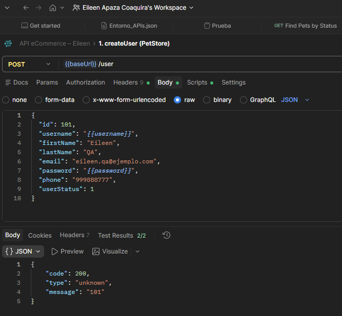
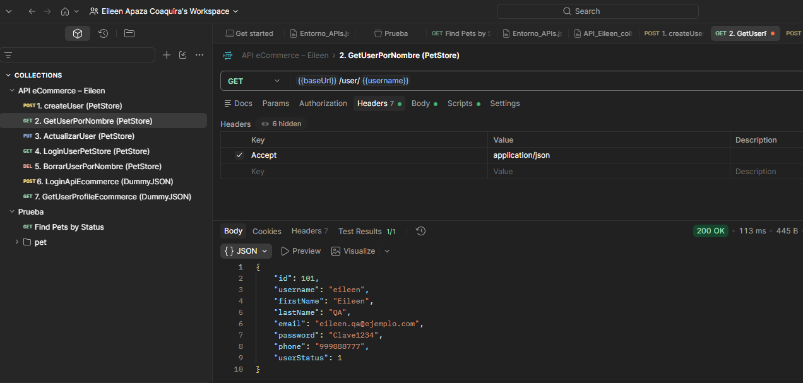
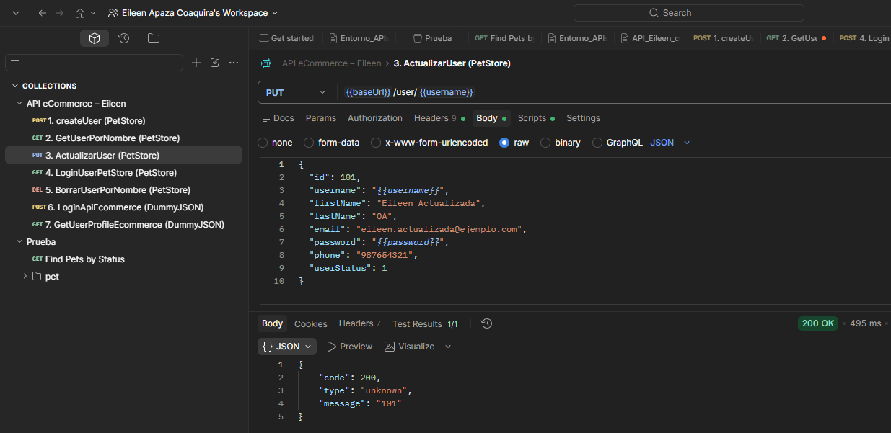
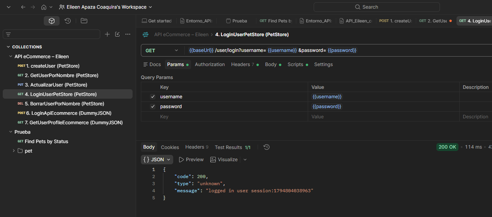
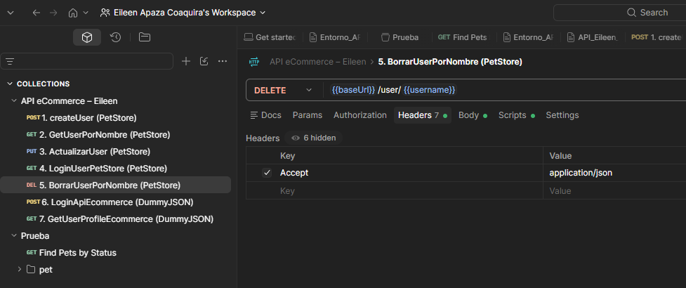
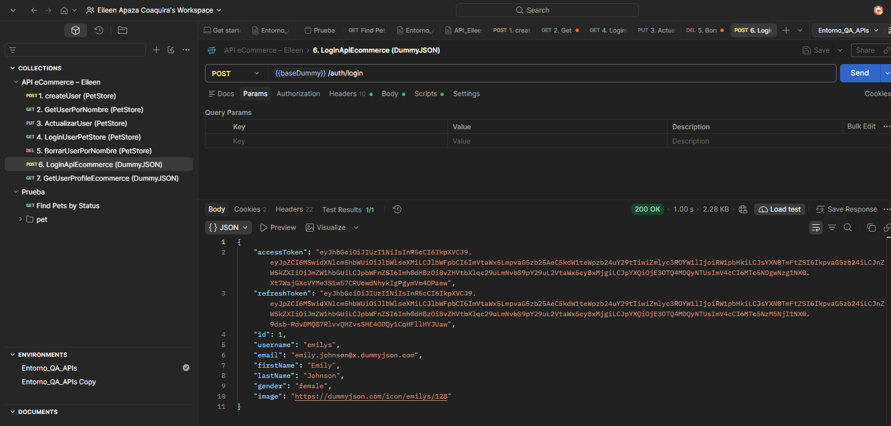
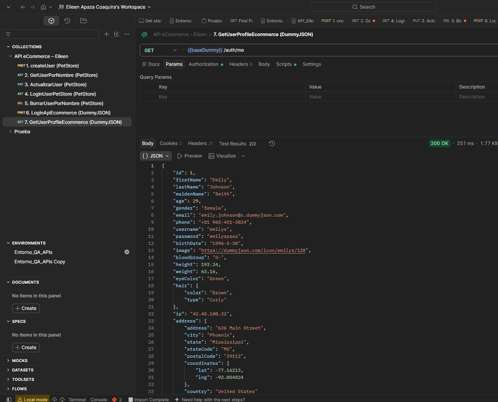

# Flujo Ecommerce

 Eileen Apaza Coaquira  

---

## 1. Variables de Entorno (`Entorno_QA_APIs`)

| Variable | Valor | Uso |
| :--- | :--- | :--- |
| `baseUrl` | `https://petstore.swagger.io/v2` | API CRUD Usuarios (PetStore) |
| `baseDummy` | `https://dummyjson.com` | API Auth y Perfil (DummyJSON) |
| `username` | `eileen` | Usuario de prueba |
| `password` | `Clave1234` | Contraseña de prueba |
| `token` | *(Dinámico)* | Token JWT capturado tras el login |

---

## 2. Endpoints Evaluados

| # | Servicio | Método | Endpoint | Estado |
| :- | :--- | :---: | :--- | :---: |
| 1 | Crear Usuario | `POST` | `{{baseUrl}}/user` | `200 OK` |
| 2 | Consultar Usuario | `GET` | `{{baseUrl}}/user/{{username}}` | `200 OK` |
| 3 | Actualizar Usuario | `PUT` | `{{baseUrl}}/user/{{username}}` | `200 OK` |
| 4 | Login PetStore | `GET` | `{{baseUrl}}/user/login` | `200 OK` |
| 5 | Eliminar Usuario | `DELETE` | `{{baseUrl}}/user/{{username}}` | `200 OK` |
| 6 | Login eCommerce (JWT) | `POST` | `{{baseDummy}}/auth/login` | `200 OK` |
| 7 | Perfil Protegido (Bearer) | `GET` | `{{baseDummy}}/auth/me` | `200 OK` |

---

## 3. Evidencias de Ejecución

* **1. Crear Usuario (`POST /user`)**  
  

* **2. Consultar Usuario (`GET /user/{{username}}`)**  
  

* **3. Actualizar Usuario (`PUT /user/{{username}}`)**  
  

* **4. Login PetStore (`GET /user/login`)**  
  

* **5. Eliminar Usuario (`DELETE /user/{{username}}`)**  
  

* **6. Login eCommerce (`POST /auth/login`)**  
  

* **7. Perfil Protegido (`GET /auth/me`)**  
  
